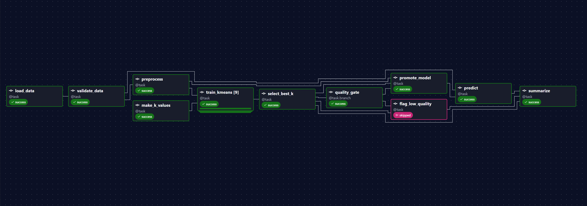
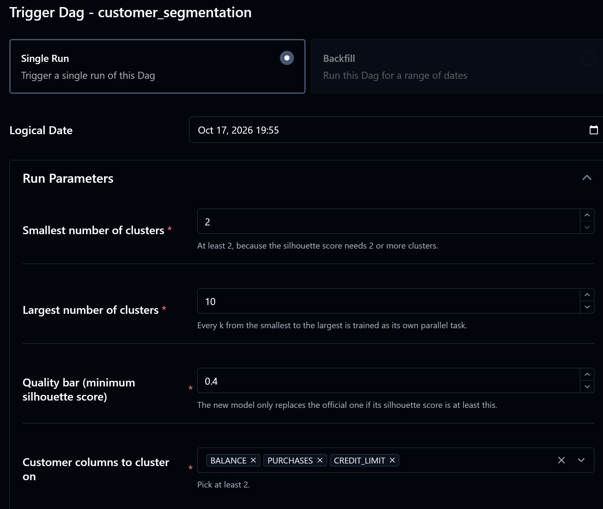
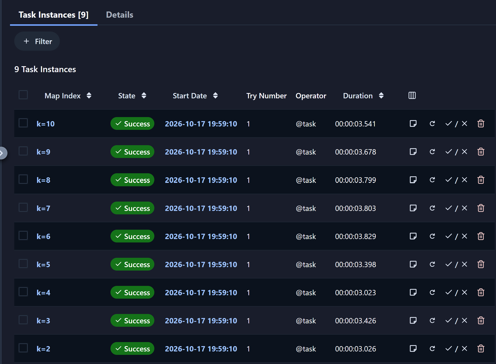
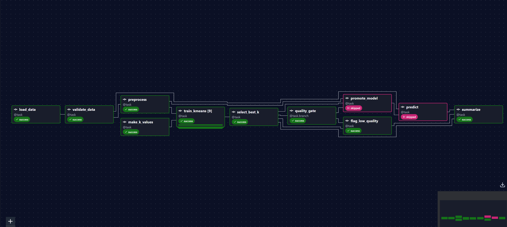

# Airflow Lab 1: Customer Segmentation Pipeline

A customer-segmentation pipeline orchestrated with **Apache Airflow 3**. It groups 8,950 credit-card customers into segments with K-Means. Airflow checks the data, trains one model per number of clusters **in parallel**, picks the best one, and only makes it the official model if it passes a **quality gate**. The cluster range, the quality bar and the columns to use are chosen in a form each time the pipeline is triggered.



## Pipeline

```
load_data ─► validate_data ─► preprocess ─┐
                                          ├─► train_kmeans  (one parallel copy per k: k=2 … k=10)
make_k_values ────────────────────────────┘          │
                                                     ▼
                                               select_best_k ─► quality_gate
                                                                 ├─ silhouette ≥ bar ─► promote_model ─► predict ─┐
                                                                 └─ below the bar ────► flag_low_quality ─────────┴─► summarize
```

| Task | What it does |
|------|--------------|
| `load_data` | Copies the raw CSV into this run's own folder, `working_data/<run id>/` |
| `validate_data` | Checks that the chosen columns exist and are numeric and that at least 100 complete rows remain, then saves `clean.csv`. Bad data stops the run at once |
| `preprocess` | Scales every column to the range 0–1 and saves the fitted scaler |
| `make_k_values` | Turns the cluster-range setting into a list, e.g. `[2, 3, …, 10]` |
| `train_kmeans` | **One copy per k, all running at the same time.** Each trains K-Means, scores it (SSE and silhouette) and saves the model |
| `select_best_k` | Collects every copy's result and picks k with the elbow method (falling back to the best silhouette if there is no clear elbow). Saves `k_scores.csv` |
| `quality_gate` | Branch: promote the model if its silhouette score reaches the quality bar, otherwise flag it |
| `promote_model` | Makes the model official by copying it, its scaler and `metrics.json` to `working_data/latest/` |
| `predict` | Uses the official model to assign the customers in `test.csv` and writes `cluster_profile.csv` |
| `flag_low_quality` | Writes `low_quality.json` explaining why the model was rejected. The official model stays unchanged |
| `summarize` | Runs after whichever path ran and writes `summary.json` |

## Airflow features used

| Feature | Where | Why |
|---------|-------|-----|
| TaskFlow API (`@dag`, `@task`) | every task | Tasks are plain Python functions; passing one task's result to another draws the arrow between them |
| Small XComs (file paths) | between all tasks | Data lives in files; Airflow's database only stores short paths and small results |
| Fail fast (`AirflowFailException`) | `validate_data`, `make_k_values` | Bad data or impossible settings stop the run immediately instead of being retried |
| Retries | every task: 2 retries, 30 s apart | Recovers from temporary problems, such as a file that arrives late |
| Dynamic task mapping (`.partial().expand()`) | `train_kmeans` | One task per k, created at run time from the settings, running in parallel and labelled `k=2`, `k=3`, … in the UI |
| Branching (`@task.branch`) | `quality_gate` | The pipeline decides which path runs; the other path is skipped |
| Trigger rule `none_failed_min_one_success` | `summarize` | Runs after whichever branch ran, even though the other one was skipped |
| Params | the Trigger form | Cluster range, quality bar and columns, checked against their rules before a run is allowed to start |

## Dataset

[Credit Card Dataset for Clustering](https://www.kaggle.com/datasets/arjunbhasin2013/ccdata): 8,950 credit-card customers, each described by 18 columns. By default the pipeline clusters them on 3 columns:

- `BALANCE`: the balance on the card
- `PURCHASES`: the amount spent on purchases
- `CREDIT_LIMIT`: the card's credit limit

One customer has no credit limit, so 8,949 customers are used. `test.csv` holds one more customer for the pipeline to assign to a cluster.

## Results

With the default settings (k from 2 to 10, quality bar 0.40, all 3 columns):

| k | SSE (lower = tighter clusters) | Silhouette (higher = better separated) |
|---|---|---|
| 2 | 131.88 | 0.559 |
| 3 | 93.88 | 0.480 |
| 4 | 74.23 | 0.514 |
| **5** | **61.18** | **0.466** |
| 6 | 53.50 | 0.427 |
| 7 | 47.56 | 0.402 |
| 8 | 42.21 | 0.396 |
| 9 | 37.65 | 0.361 |
| 10 | 34.39 | 0.359 |

The elbow method picks **k = 5**. Its silhouette score of 0.466 is above the 0.40 bar, so the model is promoted. The 5 customer segments (`cluster_profile.csv`, averages in the dataset's units):

| Cluster | Customers | Avg balance | Avg purchases | Avg credit limit | In plain words |
|---|---|---|---|---|---|
| 4 | 5,273 | 782.79 | 555.03 | 2,099.71 | everyday, low-activity customers (59%) |
| 2 | 1,734 | 703.49 | 1,409.96 | 6,555.10 | active buyers who keep their balance low |
| 1 | 1,187 | 4,148.37 | 1,070.79 | 6,736.61 | carry a large balance |
| 3 | 398 | 8,259.20 | 2,514.00 | 12,434.67 | very high balance and credit limit |
| 0 | 357 | 1,241.58 | 3,741.04 | 13,549.44 | big spenders with high credit limits |

The test customer has an unusually high credit limit (241,514), so it is assigned to cluster 0, the segment with the highest limits.

## Requirements

**On your computer** (nothing else is needed; there is no `pip install` on your machine):

| Tool | Version tested | Notes |
|------|----------------|-------|
| [Docker Desktop](https://www.docker.com/products/docker-desktop/) (Windows, macOS) or Docker Engine (Linux) | Docker 29.4.0 | Give Docker at least **4 GB of memory** (8 GB recommended): Docker Desktop → Settings → Resources |
| Docker Compose | 5.1.2 (included with Docker Desktop) | Any version that supports `docker compose` (with a space) |
| [Git](https://git-scm.com/downloads) | 2.50 | To download the repository |

**Inside the containers** (installed automatically by `docker compose build`):

| Component | Version |
|-----------|---------|
| Apache Airflow | 3.3.2 (official image `apache/airflow:3.3.2-python3.12`) |
| Python | 3.12.14 |
| PostgreSQL / Redis | 16.15 / 7.2.16 (Airflow's database and task queue) |
| pandas, scikit-learn, threadpoolctl | 3.0.5, 1.9.1, 3.6.0 (already in the Airflow image) |
| kneed, pytest | 0.8.6, 9.1.1 (added by `requirements.txt`) |

## Setup (first time only)

1. **Download the repository** and open the lab folder:

   ```
   git clone https://github.com/Pu1ni2/MLOps.git
   cd MLOps/Airflow_Labs/Lab1
   ```

2. **Create the folders Airflow writes into.** Git doesn't store empty folders, and creating them yourself makes sure you own them:

   | System | Command |
   |--------|---------|
   | Windows (PowerShell) | `mkdir logs, plugins, config, working_data` |
   | macOS / Linux | `mkdir -p logs plugins config working_data` |

3. **Create the `.env` settings file** with the command for your system:

   | System | Command |
   |--------|---------|
   | Windows (PowerShell) | `Set-Content -Path .env -Encoding ascii -Value "AIRFLOW_UID=50000", "FERNET_KEY="` |
   | macOS | `printf 'AIRFLOW_UID=50000\nFERNET_KEY=\n' > .env` |
   | Linux | `printf 'AIRFLOW_UID=%s\nFERNET_KEY=\n' "$(id -u)" > .env` |

   `AIRFLOW_UID` is the user Airflow runs as inside the containers. On Linux it must be your own user ID, so that the files Airflow creates in this folder belong to you.

4. **Build the image.** The first build downloads the Airflow image and takes a few minutes:

   ```
   docker compose build
   ```

5. **Set up Airflow's database and the login.** This runs once and stops by itself; wait for `airflow-init-1 exited with code 0`:

   ```
   docker compose up airflow-init
   ```

6. **Start Airflow** in the background, then check it:

   ```
   docker compose up -d
   docker compose ps
   ```

   After about a minute, every service shows `(healthy)`.

## Run the pipeline

**In the web UI**

1. Open **http://localhost:8080** and log in with `airflow` / `airflow`.
2. Go to **Dags** → **customer_segmentation** and switch it **on** (new DAGs start paused).
3. Click **Trigger**. The form shows the 4 settings; keep the defaults or change them, then click **Trigger** again.

   

4. Watch the run. The left panel shows the **Grid**; press **g** (or click **Show Graph**) to switch to the **Graph**. A run takes about 15–20 seconds.

**From the command line**

This runs the whole pipeline once with the default settings and prints its logs, in about 20 seconds:

```
docker compose exec airflow-worker airflow dags test customer_segmentation
```

## What a successful run looks like

- **Graph:** every task is green except `flag_low_quality`, which is skipped (pink), as in the screenshot at the top.
- **The 9 parallel copies:** click `train_kmeans` in the run and open its **Task Instances [9]** tab. The copies are labelled `k=2` to `k=10` and all start at the same second:

  

- **Task logs** (click a task → Logs):

  | Task | Line to look for |
  |------|------------------|
  | `validate_data` | `Kept 8949 of 8950 rows. Missing values: {'BALANCE': 0, 'PURCHASES': 0, 'CREDIT_LIMIT': 1}` |
  | `train_kmeans` (k=5) | `k=5: SSE 61.18, silhouette 0.466` |
  | `select_best_k` | `Best k: 5 (by elbow), silhouette 0.466` |
  | `quality_gate` | `Silhouette 0.466 >= 0.4: promoting the model` |
  | `predict` | `Clusters: [0]` |

- **Files** in `Airflow_Labs/Lab1/working_data/` on your computer:

  ```
  working_data/
  ├── manual__<date and time>/        one folder per run
  │   ├── raw.csv, clean.csv, scaled.csv, scaler.joblib
  │   ├── models/kmeans_k2.joblib … kmeans_k10.joblib
  │   ├── k_scores.csv                SSE and silhouette for every k
  │   ├── cluster_profile.csv         size and averages of each cluster
  │   └── summary.json                the settings used and the decision
  └── latest/                         the official model: model.joblib, scaler.joblib, metrics.json
  ```

  `summary.json` of a default run (silhouette shortened):

  ```json
  {
    "settings": {"k_min": 2, "k_max": 10, "min_silhouette": 0.4, "features": ["BALANCE", "PURCHASES", "CREDIT_LIMIT"]},
    "best_k": 5,
    "method": "elbow",
    "silhouette": 0.466,
    "decision": "promoted",
    "test_clusters": [0]
  }
  ```

- **When a model is below the bar** (for example with the quality bar set to 0.9), the other path runs instead. `flag_low_quality` writes `low_quality.json`, `promote_model` and `predict` are skipped, and the official model in `latest/` is not replaced:

  

## Try different settings

Measured with the Trigger form:

| Settings | What happens |
|----------|--------------|
| Largest number of clusters = 6 | Only **5** parallel `train_kmeans` copies. Such a short range has no clear elbow, so the best silhouette decides: k = 2 (0.559) → promoted |
| Quality bar = 0.9 | k = 5 (0.466) is below the bar → flagged, and the official model is not replaced |
| Columns = BALANCE, PURCHASES | k = 5 with silhouette 0.509 → promoted |
| Smallest = 8, largest = 5 | The run fails at once in `make_k_values`: `k_min (8) must be smaller than k_max (5)` |
| Largest = 50, only 1 column, or an unknown column | Refused before the run starts, with a message saying which rule was broken |

## Tests

```
docker compose exec airflow-worker pytest /opt/airflow/tests -v
```

Expected result: `39 passed` in about 3 seconds.

- **`tests/test_dag.py`** (23 tests) loads the DAG the way Airflow does and checks:
  - it has no import errors;
  - all 11 tasks are present, and every connection is correct;
  - `train_kmeans` is mapped (parallel);
  - `summarize`'s trigger rule;
  - 2 retries, 30 s apart, on every task;
  - it runs only when triggered;
  - the default settings, and that invalid settings are rejected.
- **`tests/test_lab.py`** (16 tests) checks the logic without Airflow:
  - validation on the real data and on 3 kinds of bad data;
  - scaling to 0–1;
  - training one model;
  - the elbow on data with 3 known groups (given in shuffled order), and the silhouette fallback;
  - the gate rule at exactly the bar;
  - promotion, prediction, the cluster profile and the low-quality report.

## Stop and clean up

| Goal | Command |
|------|---------|
| Stop Airflow, keep the run history | `docker compose down` |
| Stop Airflow and delete its database (all run history) | `docker compose down -v` |

The pipeline's output files stay in `working_data/` until you delete that folder.

## Troubleshooting

| Problem | Fix |
|---------|-----|
| Port 8080 is already in use (for example by another Airflow) | Add the line `AIRFLOW_HOST_PORT=8081` to `.env`, run `docker compose up -d` again, and open http://localhost:8081 |
| `customer_segmentation` doesn't appear | Wait about 30 seconds, since Airflow re-reads the `dags` folder regularly. A red "Dag Import Errors" banner at the top of the page shows the reason if a file can't be loaded |
| Docker reports an error about `.env` (Windows) | The file must be plain ASCII. Create it with the `Set-Content` command above, not with `echo ... > .env` |
| Windows can't open some folders inside `logs/` | Their names contain `:`, which Windows doesn't allow. Read the logs in the Airflow UI instead |
| Containers keep restarting or are very slow | Give Docker more memory (at least 4 GB) |
| Git Bash: pytest finds no tests | Git Bash rewrites paths starting with `/opt/...`. Use PowerShell, or start the command with `MSYS_NO_PATHCONV=1` |

## Project structure

```
Airflow_Labs/Lab1/
├── docker-compose.yaml            # Airflow 3.3.2 services (the official file, adapted)
├── Dockerfile                     # official Airflow image + requirements.txt
├── requirements.txt               # pinned Python packages
├── dags/
│   ├── customer_segmentation.py   # the DAG: tasks, settings, parallel training, branching
│   ├── src/lab.py                 # the logic, as plain Python with no Airflow
│   └── data/file.csv, test.csv
├── tests/
│   ├── conftest.py                # test setup
│   ├── test_dag.py                # DAG structure and settings
│   └── test_lab.py                # logic
└── screenshots/

Created while running (ignored by git): .env, logs/, config/, plugins/, working_data/
```

## My changes

Compared with the [original lab](https://github.com/raminmohammadi/MLOps/tree/main/Labs/Airflow_Labs/Lab_1):

**Setup**
- **Airflow 3.3.2 with its own image.** The original instructions downloaded Airflow 2.x compose files (2.5.1 and 2.9.2) that don't match the lab's Airflow 3 code, and installed packages on every container start with `_PIP_ADDITIONAL_REQUIREMENTS`, which Airflow marks as "for quick checks only". This lab builds a small image from `requirements.txt` with pinned versions.
- **Compose changes:** example DAGs hidden, a configurable web port, and the `working_data/` (outputs) and `tests/` folders mounted into the containers.

**Pipeline (orchestration)**
- **TaskFlow API:** the DAG is rewritten with `@dag` and `@task`.
- **File paths instead of data in XCom.** The original pushed the whole dataset through XCom as base64 pickles: 1,793,304 characters stored in Airflow's database, and printed again as a 1.8 MB line in the task log. Tasks now pass file paths (`load_data`'s XCom is 74 characters) and small results.
- **Data validation and retries.** A new `validate_data` task stops the run at once, with a clear message, when the data is bad (`AirflowFailException`). Every task retries twice, 30 seconds apart, for temporary problems.
- **Parallel training with dynamic task mapping.** Instead of one task training 49 models in a loop, one `train_kmeans` task per k runs in parallel, labelled `k=2` … `k=10`.
  - Each copy uses 1 CPU thread. With scikit-learn's default of every thread per task, 9 parallel models took 26.7 s instead of 0.5 s, because they fought over the CPU.
  - A whole run now takes about 15–20 seconds, compared with about 95 seconds when one task trained 49 models.
- **Quality gate.** A branch promotes the model to `working_data/latest/` only if its silhouette score reaches the bar, and otherwise flags it. A summary task with the trigger rule `none_failed_min_one_success` runs after either path.
- **Params:** the cluster range, quality bar and columns are set in the Trigger form and checked before the run starts.
- **Tests:** 39 pytest tests (the original had none), plus a one-command test run with `airflow dags test`.

**Fixes**
- The original saved the **k = 49 model**, whatever the elbow method said. Now the chosen model is saved.
- The original fed **unscaled** test data to a model trained on scaled data. Now the training scaler is saved and reused.
- The original wrote its model **inside `dags/`**. Outputs now go to `working_data/`.
- **Choosing k:** the elbow is now searched over k = 2–10, where it is stable (k = 5 whether the range ends at 10, 12 or 15). The original's 1–49 range moved it to 8. The silhouette score is reported for every k and used as a fallback.
- **New output:** `cluster_profile.csv` describes each customer segment.

## Dataset credit

[Credit Card Dataset for Clustering](https://www.kaggle.com/datasets/arjunbhasin2013/ccdata) by Arjun Bhasin, Kaggle, released under [CC0: Public Domain](https://creativecommons.org/publicdomain/zero/1.0/).
