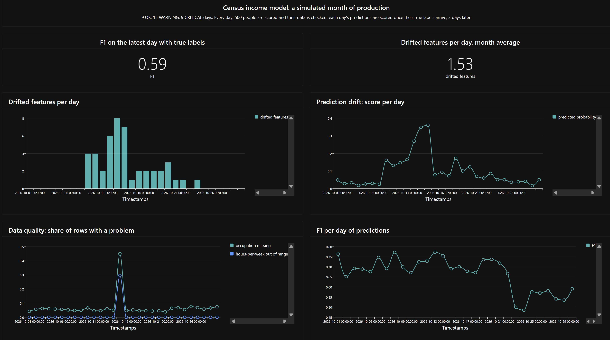
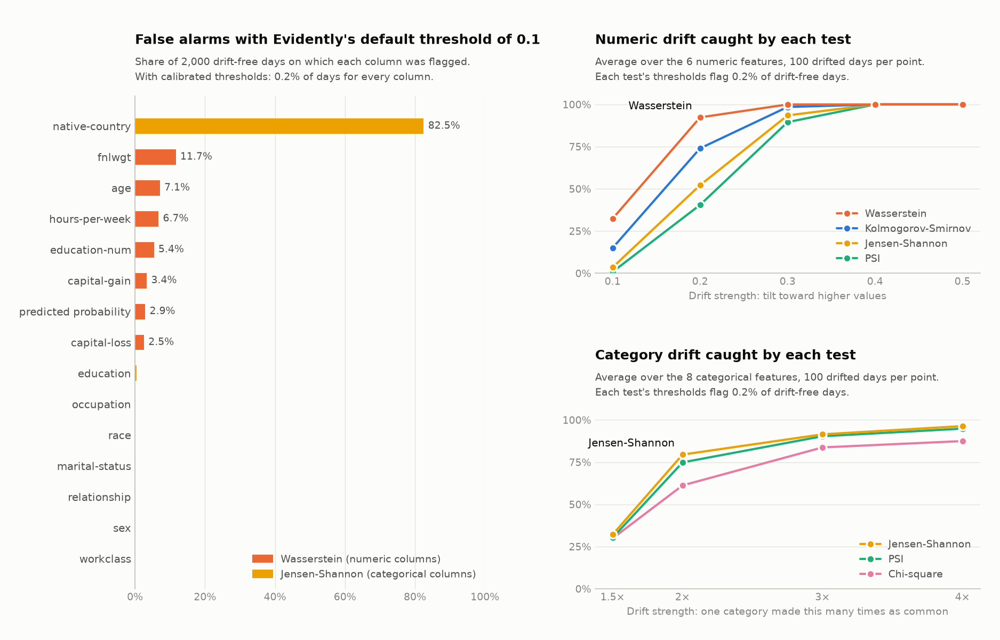
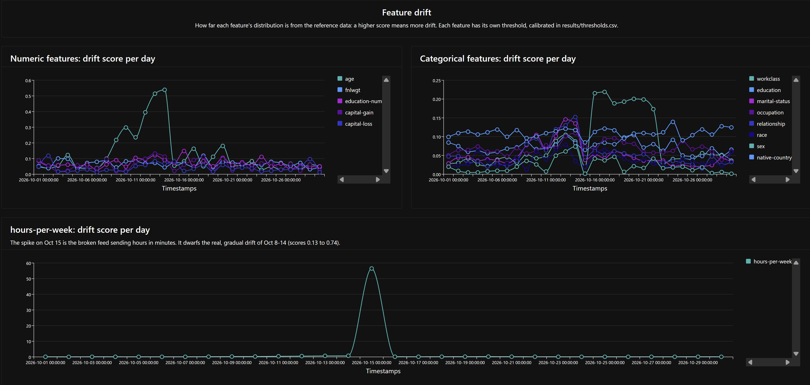
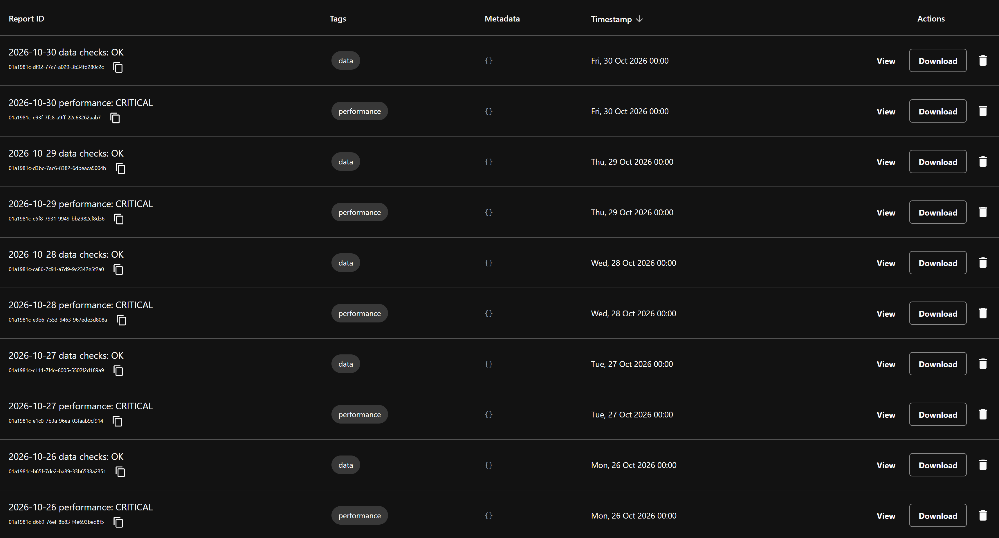
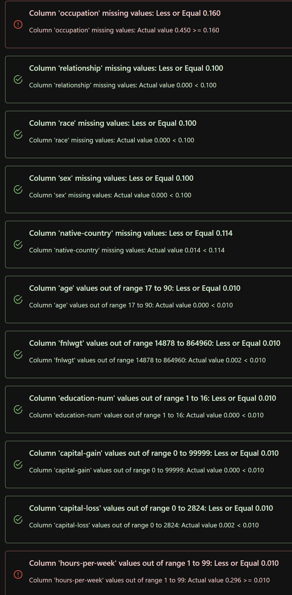

# Data Monitoring Lab: Drift Monitoring with Evidently

A production-style monitoring system for an income-prediction model, built with **Evidently 0.7**. A simulated month of production traffic (500 people a day) flows through a trained model, with four kinds of drift injected on schedule. Every day, Evidently reports check the data quality, the feature drift and the model's predictions. Each day's predictions are scored again once their true labels arrive, 3 days later. A gate turns the failed tests into **OK / WARNING / CRITICAL** and writes alerts. Every report goes to a self-hosted Evidently dashboard that is defined in code. The drift thresholds aren't guessed: a calibration study on thousands of simulated days picks the tests and sets a threshold for each column.



## How it works

```
config/scenario.yaml ─► 30 simulated days, 500 people each, with drift injected on schedule
                               │
UCI Adult data ─► model ───────┤ each day: the model's predictions; the true labels arrive 3 days later
                               ▼
      Evidently reports with tests: data quality · feature drift · prediction drift · performance
                               ▼
      gate (config/monitoring.yaml): OK / WARNING / CRITICAL ─► alerts.jsonl and the console
                               ▼
      every report ─► Evidently dashboard (Docker) at http://localhost:8000
```

| Check | Evidently metric and test | Fails when | Status |
|-------|---------------------------|------------|--------|
| Data quality | `MissingValueCount`, `OutRangeValueCount` | a column has 10 percentage points more missing values than the reference data, or more than 1% of a numeric column falls outside the reference range | CRITICAL |
| Feature drift | `DataDriftPreset`: Wasserstein distance for numbers, Jensen-Shannon distance for categories, with a calibrated threshold for each column | at least 1 of the 14 features drifts | WARNING |
| Prediction drift | `ValueDrift` on the predicted probability of earning >50K | the drift score reaches 0.146 | WARNING |
| Performance, once the labels arrive | `F1Score` (accuracy, precision, recall and ROC AUC are measured too) | F1 falls below 0.61 (the 0.71 baseline minus 0.10) | CRITICAL |

The income label itself is never part of the drift checks: production data doesn't have it until days later.

## The simulated month

The month is defined in [config/scenario.yaml](config/scenario.yaml). The same seed always produces the same month. This is what was injected and what the monitoring caught:

| Days | Injected event | What changes | What the monitoring reported |
|------|----------------|--------------|------------------------------|
| 1–7 | none | nothing | OK |
| 8–14 | `older_longer_hours` | older people who work longer hours become more likely, a bit more each day (at full strength the average age goes from 39 to 47) | WARNING. Day 8: prediction drift, before any single feature crosses its threshold. From day 9: age and hours drift, plus the knock-on shifts in marital status and relationship |
| 15 | `broken_upstream_feed` | hours sent in minutes for 30% of rows; 40% of occupations lost | **CRITICAL**: 45% of occupations missing, 29.6% of hours outside 1–99 |
| 16–22 | `more_self_employed` | self-employed people become 4 times as likely | WARNING: `workclass` drifts every day |
| 23–30 | `degree_premium_drops` | half of the degree holders who earned >50K now earn ≤50K, while the people look exactly the same | Days 23–25: nothing in the data. From day 26 (Oct 26) to Nov 2, as each day's labels arrive: **CRITICAL**, F1 0.49–0.59 |

Totals: **9 OK, 15 WARNING and 9 CRITICAL days**. The run continues 3 days after the last batch, so the last batches' labels are checked too. The only false alarm in the month is day 24, where `native-country` scored 0.139 against its threshold of 0.135.

Three lessons show up in the month:

- **Concept drift is invisible to data checks.** Only the true labels reveal it, and only after the label delay.
- **Drift doesn't always hurt the model.** Days 8–22 drifted a lot, but F1 stayed within its normal range. That is why drift is a WARNING and a confirmed drop in F1 is CRITICAL.
- **Some problems can't wait for labels.** The broken feed barely changed F1, yet the data was clearly broken, and only the immediate data-quality check noticed.

## Choosing the drift tests and thresholds

[src/monitoring/calibrate.py](src/monitoring/calibrate.py) runs the same Evidently drift tests the reports use (their scores match exactly, and a test checks this) on simulated days:

1. **Normal days.** On 2,000 days without drift, it sets each column's threshold so that only 1 normal day in 500 crosses it.
2. **A fair comparison.** With every test calibrated to that same false-alarm rate, it measures how often each test catches drift of growing strength.
3. **A fresh check.** It counts false WARNINGs on 1,000 new normal days, with Evidently's defaults and with the calibrated thresholds.



| Result | Value |
|--------|-------|
| Normal days with a false drift WARNING, with Evidently's default threshold of 0.1 | **88.6%** |
| The same, with the calibrated thresholds | **3.4%** |
| Numeric drift caught at the same false-alarm rate | Wasserstein 84.9%, Kolmogorov-Smirnov 77.5%, Jensen-Shannon 69.8%, PSI 66.2% |
| Category drift caught at the same false-alarm rate | Jensen-Shannon 74.9%, PSI 72.6%, chi-square 65.6% |
| Normal days on which the F1 rule fires | 0.55% |

What it showed:

- **Evidently's default tests are the right ones; only their single threshold was wrong.** Wasserstein and Jensen-Shannon, the tests Evidently uses by default for data this size, caught the most drift.
- **One threshold can't fit every column.**
  - `native-country` has 41 categories, so random noise in 500 rows alone crossed 0.1 on 82.5% of normal days. Its calibrated threshold is 0.135.
  - Steady columns such as `sex` (0.046) and `race` (0.065) get thresholds below 0.1, so they are now more sensitive.
- **Chi-square fails on rare categories.** The 5,000-row reference data contains 38 of the 41 countries. On the 41% of days that include one of the other 3, chi-square divides by zero and reports certain drift.

The tables are in [results/](results/): `thresholds.csv` (every column and test), `detection.csv`, `false_warnings.csv` and `performance_noise.csv`. The chosen settings are in [config/monitoring.yaml](config/monitoring.yaml).

## Data and model

- **Data:** [UCI Adult (Census Income)](https://archive.ics.uci.edu/dataset/2/adult), with 48,842 people, 14 features and an income label (24% earn >50K).
  - Missing values: workclass (2,799), occupation (2,809) and native-country (857).
  - A gzipped copy from OpenML (data id 1590) is in `data/`, so running the lab needs no download.
- **Split:**
  - 15,000 people to train the model.
  - 5,000 as the **reference data**: the model's baseline, and what every day is compared with.
  - The remaining 28,842 as the pool the simulated days are drawn from.
- **Model:** a scikit-learn pipeline: missing categories filled in, one-hot encoding, then `HistGradientBoostingClassifier`. On the reference data:

  | Accuracy | Precision | Recall | F1 | ROC AUC |
  |---|---|---|---|---|
  | 0.872 | 0.777 | 0.654 | 0.710 | 0.926 |

## Requirements

**On your computer** (nothing else is needed; there is no `pip install` on your machine):

| Tool | Version tested | Notes |
|------|----------------|-------|
| [Docker Desktop](https://www.docker.com/products/docker-desktop/) (Windows, macOS) or Docker Engine (Linux) | Docker 29.4.0 | Docker Desktop must be running |
| Docker Compose | v5.1.2 (included with Docker Desktop) | Any version that supports `docker compose` (with a space) |
| [Git](https://git-scm.com/downloads) | 2.50 | To download the repository |

**Inside the containers** (downloaded and installed automatically by the setup steps below):

| Component | Version |
|-----------|---------|
| Evidently dashboard service | 0.7.23 (official image `evidently/evidently-service:0.7.23`) |
| Python for the monitoring jobs | 3.12.16 (image `python:3.12-slim`) |
| evidently, pandas, numpy, scikit-learn | 0.7.23, 3.0.5, 2.5.4, 1.9.1 |
| pyyaml, matplotlib, pytest | 6.0.3, 3.11.2, 9.2.0 |

The lab's Python packages are pinned in [requirements.txt](requirements.txt). pandas stays at 3.0.5 because Evidently 0.7.23 doesn't work with pandas 3.1, and numpy is pinned because the simulated days come from its random generator.

## Setup (first time only)

1. **Download the repository** and open the lab folder:

   ```
   git clone https://github.com/Pu1ni2/MLOps.git
   cd MLOps/Data_Labs/Data_Monitoring
   ```

2. **Build the image** for the monitoring jobs. The first build downloads Python and the packages, and takes about 3 minutes:

   ```
   docker compose build monitor
   ```

3. **Start the dashboard** in the background, then check it:

   ```
   docker compose up -d
   docker compose ps
   ```

   After about 15 seconds, the `ui` service shows `(healthy)`. The dashboard is at **http://localhost:8000**. It has no projects until the first run.

## Run the monitoring

```
docker compose run --rm monitor python -m monitoring.simulate
```

This runs the whole simulated month in about a minute. The first run also trains the model, which takes about 10 seconds. It prints one line per day, writes the alerts to `alerts.jsonl` and ends with a link to the dashboard. Each run replaces the previous run's project, so open the link from the latest run.

Other jobs, run the same way (`docker compose run --rm monitor python -m <module>`):

| Module | What it does | Time |
|--------|--------------|------|
| `monitoring.scenarios` | Prints a few numbers for each simulated day, so every injected event can be seen in them | 10 s |
| `monitoring.calibrate` | Runs the calibration study again and rewrites `results/` with the same numbers | 5–15 min |
| `monitoring.baseline` | Runs the original lab's single report (the education split) as a separate dashboard project | 20 s |
| `monitoring.model` | Trains the model again and saves it to `models/` | 10 s |
| `monitoring.fetch_data` | Downloads the data again from OpenML (needs an internet connection); the file comes out identical to the one in `data/` | 15 s |

## What a successful run looks like

**The console** (shortened; on the first run, two lines about training the model come first):

```
day  1  2026-10-01  OK
...
day  8  2026-10-08  WARNING   [injected: older_longer_hours]
      prediction_drift: score 0.162 (threshold 0.146)
day  9  2026-10-09  WARNING   [injected: older_longer_hours]
      feature_drift: 4 of 14 features drifted: age 0.219, hours-per-week 0.217, marital-status 0.0777, relationship 0.0794
...
day 15  2026-10-15  CRITICAL  [injected: broken_upstream_feed]
      data_quality: occupation 45.0% missing (limit 16.0%)
      data_quality: hours-per-week 29.6% outside 1 to 99 (limit 1.0%)
      feature_drift: 1 of 14 features drifted: hours-per-week 56.5
...
day 23  2026-10-23  OK        [injected: degree_premium_drops]
...
day 26  2026-10-26  CRITICAL  [injected: degree_premium_drops]
      performance: predictions of 2026-10-23: f1 0.500 (limit 0.610)
...
day 33  2026-11-02  CRITICAL  [no new batch, only labels]
      performance: predictions of 2026-10-30: f1 0.591 (limit 0.610)

9 OK, 15 WARNING, 9 CRITICAL days. Alerts written to alerts.jsonl
Dashboard: http://localhost:8000/projects/<project id>
```

The `[injected: ...]` notes only exist because this is a simulation. They show what the checks should catch.

**`alerts.jsonl`** has one alert per WARNING or CRITICAL day, for example:

```json
{"day": 15, "date": "2026-10-15", "status": "CRITICAL", "failed_checks": [
  {"check": "data_quality", "message": "occupation 45.0% missing (limit 16.0%)"},
  {"check": "data_quality", "message": "hours-per-week 29.6% outside 1 to 99 (limit 1.0%)"},
  {"check": "feature_drift", "message": "1 of 14 features drifted: hours-per-week 56.5"}]}
```

**The dashboard** (open the printed link) shows the project "Census income model: daily monitoring":

- At the top: the month's totals, the latest F1 and drifted-feature counts, and charts of drifted features, prediction drift, data quality and F1 per day (the screenshot at the top of this page).
- Further down: the drift score of every feature, the missing and out-of-range values, and all performance metrics:

  

- **Reports**: 60 reports, a data report per day and a performance report per day. Each is named after its own result, so the failed days stand out:

  

- Opening a report shows its Evidently metrics and tests. The data report of Oct 15, the broken feed:

  

**Files** created in the lab folder (all ignored by git): `models/` (the model, the scored reference data and its metrics), `workspace/` (the dashboard's data) and `alerts.jsonl`.

## Tests

```
docker compose run --rm monitor pytest
```

Expected result: `31 passed`, in under a minute. The tests use temporary folders, so they never touch the dashboard or `alerts.jsonl`.

| File | What it checks |
|------|----------------|
| `test_scenarios.py` | The same seed gives the same day; events change only their own days; gradual drift grows; labels stay apart from the production data; the broken feed and the concept drift do what they claim; bad scenario files are rejected |
| `test_gate.py` | Every severity rule (OK / WARNING / CRITICAL), and alerts written as JSON lines |
| `test_checks.py` | Real reports on known days: a normal day passes everything, the broken feed is CRITICAL, more self-employed people drift `workclass`, and concept drift only shows in performance; bad monitoring configs are rejected |
| `test_calibration.py` | The study's drift scores equal the reports' scores; `monitoring.yaml` uses exactly the thresholds in `results/thresholds.csv`; fewer than 10% of 200 fresh normal days raise a drift WARNING |
| `test_dashboard.py` | One tab with every panel listed once; setting up twice never duplicates anything; every chart line reads a metric the reports actually contain |
| `test_simulate.py` | A whole 3-day run, done twice: still 6 reports, not 12, and the broken day raises a CRITICAL alert |

## Stop and clean up

| Goal | Command |
|------|---------|
| Stop the dashboard and keep the reports | `docker compose down` |
| Delete all the reports | Stop the dashboard, then delete the `workspace` folder |
| Start completely fresh | Stop the dashboard, then delete `workspace`, `models` and `alerts.jsonl` |

## Troubleshooting

| Problem | Fix |
|---------|-----|
| Port 8000 is already in use | Create a `.env` file containing `EVIDENTLY_PORT=8001` (Windows PowerShell: `Set-Content -Path .env -Encoding ascii -Value "EVIDENTLY_PORT=8001"`), run `docker compose up -d` again, and open http://localhost:8001. The link printed by the run uses the new port too |
| `Can't reach the Evidently dashboard service` | Start it with `docker compose up -d`, and wait until `docker compose ps` shows `(healthy)` |
| The dashboard link says the project doesn't exist | Each run replaces the project. Use the link from the latest run, or open http://localhost:8000 and pick the project |
| `docker compose run` waits before starting | It starts the dashboard first if it isn't running, and waits until it is ready |

## Project structure

```
Data_Labs/Data_Monitoring/
├── docker-compose.yaml        # the Evidently dashboard service and the monitoring jobs' container
├── Dockerfile                 # Python 3.12 + requirements.txt
├── requirements.txt           # pinned Python packages
├── pytest.ini
├── config/
│   ├── scenario.yaml          # the simulated month: days, batch size, label delay, drift events
│   └── monitoring.yaml        # the monitoring rules: thresholds and severities
├── data/adult.csv.gz          # UCI Adult (CC BY 4.0)
├── src/monitoring/
│   ├── data.py                # loading, column types, and the train / reference / pool split
│   ├── model.py               # the income model and its baseline metrics
│   ├── scenarios.py           # daily batches with drift injected
│   ├── checks.py              # the Evidently reports and their tests
│   ├── gate.py                # OK / WARNING / CRITICAL, and the alerts
│   ├── dashboard.py           # the dashboard, defined in code
│   ├── simulate.py            # the daily monitoring run
│   ├── calibrate.py           # the drift test comparison and calibration study
│   ├── workspace.py           # where reports go: the dashboard service, or a local folder
│   ├── baseline.py            # the original lab's single report
│   └── fetch_data.py          # downloads the data from OpenML
├── results/                   # calibration tables and chart
├── tests/                     # 31 pytest tests
└── screenshots/

Created while running (ignored by git): models/, workspace/, reports/, alerts.jsonl, .env
```

## My changes

Compared with the [original lab](https://github.com/raminmohammadi/MLOps/tree/main/Labs/Data_Labs/Data_Monitoring/Evidently_AI), a single notebook that splits the Adult data in two by education level and runs one Evidently data-drift report on the two halves:

**Monitoring over time, instead of one comparison**
- **A simulated production month.** It has daily batches, four drift events of different kinds (gradual, sudden, a category shift and concept drift), and true labels that arrive 3 days late.
  - The original's split guaranteed drift: the "current" half held only 3 education levels that the "reference" half never had.
  - Even so, when it is re-run with Evidently 0.7.23 (`monitoring.baseline`), only 5 of its 15 columns count as drifted. That is below Evidently's default of half, so its verdict is "no dataset drift".
- **A model to monitor**, so the monitoring covers its predictions and its performance, not only its input data. The original had no model.

**Checks, gate and alerts**
- **Evidently tests with thresholds** for data quality, feature drift, prediction drift and performance. The original only produced a report, with no tests.
- **The income label is kept out of the drift checks.** The original treated it as one of the drifting columns, but production data has no label until later.
- **A gate** that turns failed tests into OK / WARNING / CRITICAL, with alerts written to `alerts.jsonl`.

**Dashboard defined in code**
- **A self-hosted Evidently service in Docker.** The project and its 15 panels are created by code on every run, without duplicates. The original saved a single HTML report.
- **Two Evidently 0.7.23 limits worked around:**
  - The open-source service allows only one tab, so text panels mark the sections.
  - `add_panel` lists a panel twice, so the whole dashboard is saved in one call.

**Calibrated thresholds**
- **A study comparing 5 drift tests at the same false-alarm rate**, with a threshold for each column. False drift WARNINGs on normal days went from 88.6% to 3.4%.
- **It found that Evidently's default tests were the right choice**, and explained why chi-square fails on rare categories.

**Engineering**
- **Runs in Docker** with pinned versions. pandas is pinned to 3.0.5 because Evidently 0.7.23 doesn't import with pandas 3.1.
- **Data stored in the repository**, so a run needs no download.
- **Reproducible**: seeded simulation and training.
- **Config files checked when they are loaded.**
- **31 tests.** The original had none.
- **Evidently's usage telemetry is switched off.**

## Dataset credit

Becker, B. and Kohavi, R. (1996). [Adult](https://doi.org/10.24432/C5XW20) [Dataset]. UCI Machine Learning Repository. Licensed under [CC BY 4.0](https://creativecommons.org/licenses/by/4.0/). The copy in `data/` comes from [OpenML](https://www.openml.org/d/1590) (data id 1590).
