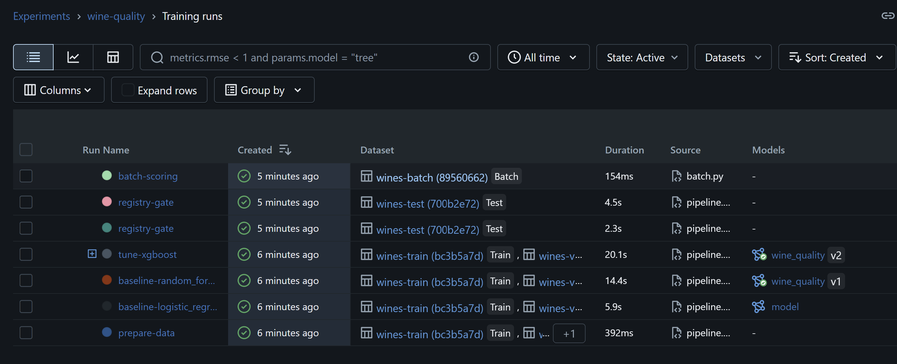
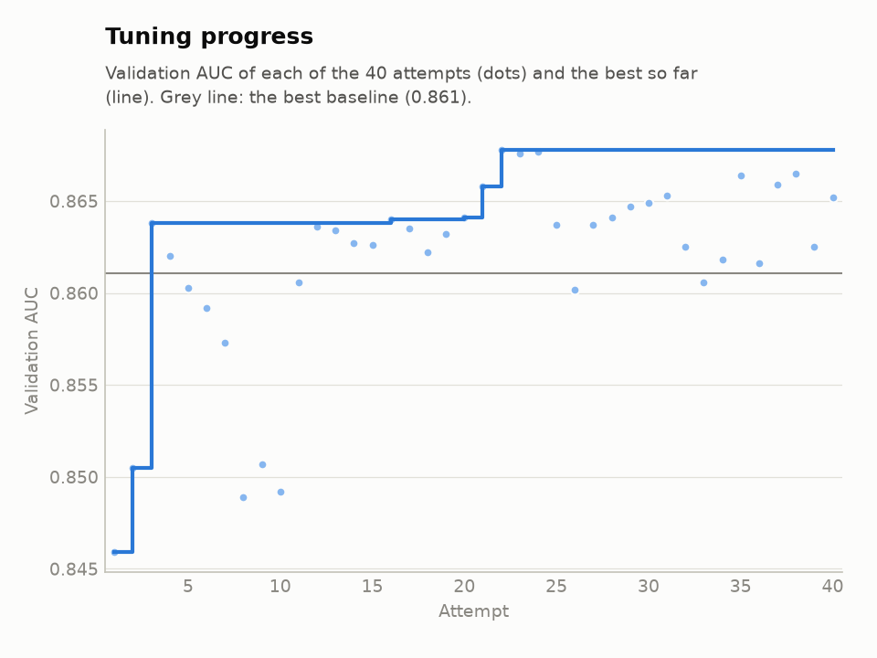
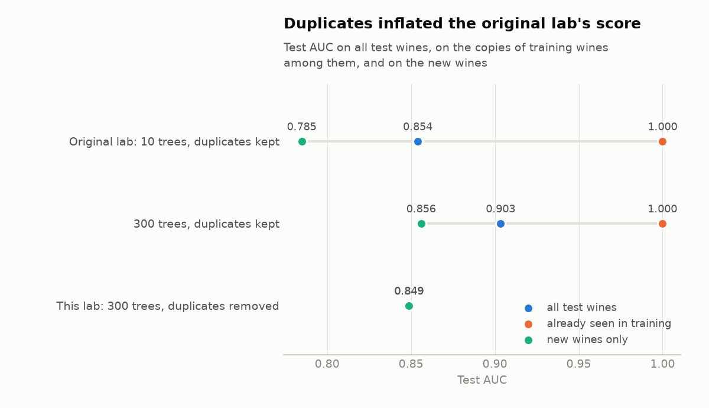
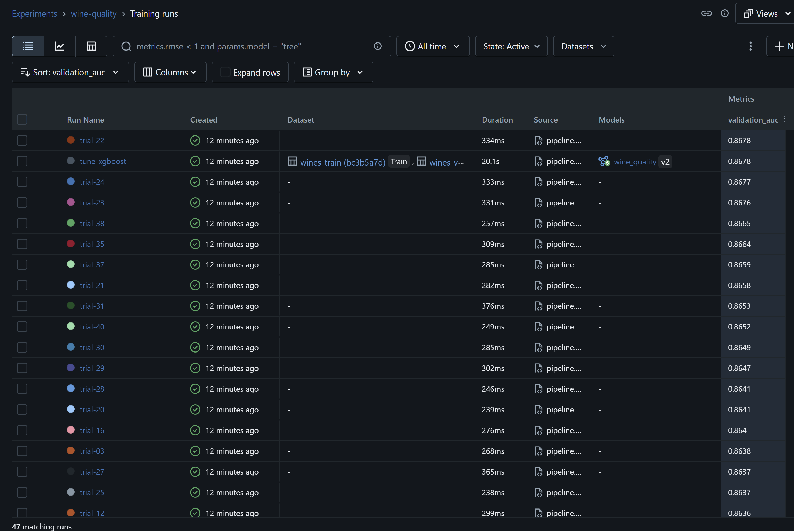
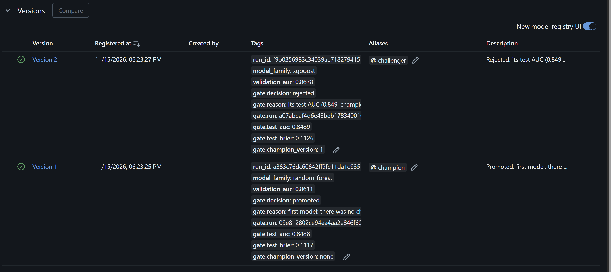
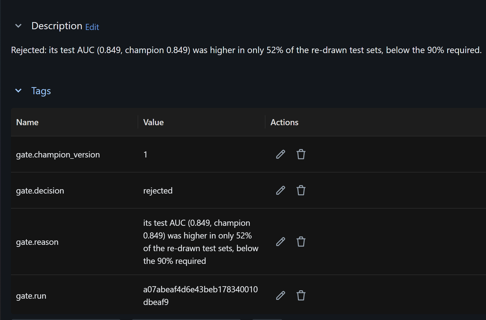

# MLflow Lab: Experiment Tracking, Model Registry and Serving

A complete MLflow workflow for predicting high-quality wines from 11 lab measurements, run on a self-hosted MLflow server (Docker + PostgreSQL).

**Everything is tracked:**
- the data split, with fingerprints of each dataset;
- the baseline models, with scores and evaluation charts;
- an Optuna search over XGBoost, with **one nested run per attempt**.

**A model registry decides what gets deployed.** A new model (the *challenger*) replaces the *champion* only if it is better on unseen test wines **and not by luck**.

**The champion is put to work:**
- served as a REST API, with a check that the server answers exactly like the registry's champion;
- used for batch scoring, which records which model version made each prediction.

**A study reproduces the original lab's reported score exactly**, and shows how duplicate wines inflated it.



## How it works

```
docker compose
  postgres ── MLflow's database: experiments, runs, parameters, metrics, model registry
  mlflow   ── MLflow server + UI at http://localhost:5050 (it also stores the runs' files)
  trainer  ── the lab's jobs (Python 3.12 + pinned packages)
  serve    ── the registry's @champion as a REST API at http://localhost:5001

python -m wine_quality.pipeline
  1. data      ─► run "prepare-data"      settings, counts, train/validation/test datasets (fingerprints)
  2. baselines ─► one run per model       logistic regression, random forest: scores, charts, model
  3. tuning    ─► run "tune-xgboost"      + 40 nested runs, one per attempt; the best model, progress chart
  4. registry  ─► run "registry-gate"     new model version, judged against @champion on the test wines
```

| Step | What MLflow records |
|------|---------------------|
| Data | The settings, the counts (wines, duplicates, split sizes), and the three datasets with their **fingerprints**, so every later run shows which data it used |
| Baselines | Settings, validation scores (AUC, average precision, log loss, Brier score, precision, recall), 4 charts (ROC, precision-recall, confusion matrix, feature importance), and the model with its input schema and an example |
| Tuning | A parent run with the winning settings, scores, charts and model, and **one nested child run per attempt** with its settings and validation scores |
| Registry gate | A new **model version** with the alias `@challenger`. Both models are scored on the test wines, and the decision (promoted or rejected, and why) is written on the version as tags and a description |
| Batch scoring | The input data, the predictions file and the model version that made them |

The test wines are never used to train or choose models; only the registry gate uses them. Models are chosen on the validation wines.

## Results

**The models, on the 1,064 validation wines:**

| Model | AUC | Average precision | Log loss | Brier |
|-------|-----|-------------------|----------|-------|
| Logistic regression | 0.821 | 0.508 | 0.379 | 0.121 |
| Random forest | 0.861 | 0.591 | 0.342 | 0.110 |
| **XGBoost, tuned** (best of 40 attempts) | **0.868** | **0.604** | **0.338** | **0.108** |



**The registry gate, on the 1,064 test wines:**
- The random forest, the best baseline, became the first champion.
- The tuned XGBoost was **rejected**: on the test wines both models score **0.849**.
- The gate re-drew the test wines at random 1,000 times. The tuned model won only **52%** of those re-draws, a coin flip, against the 90% required.

So the champion stays: tuning's small edge on the validation wines didn't hold up on new wines. That's the gate's job, not a failure: the original lab would have promoted the new model without comparing.

**The original lab's score, reproduced and explained.** Its exact code, run today, prints its reported test AUC to the last digit: **0.8540300975814177**. But it split the data with 1,177 duplicate wines still in it, so 269 of its 1,300 test wines were copies of training wines:

| Setup | AUC on all test wines | On the test wines already seen in training | On the new test wines |
|-------|------|------|------|
| Original lab: 10 trees, duplicates kept | 0.854 | **1.000** (269 wines) | **0.785** (1,031 wines) |
| 300 trees, duplicates kept | 0.903 | 1.000 | 0.856 |
| This lab: 300 trees, duplicates removed | 0.849 | none | 0.849 (1,064 wines) |



The models answer perfectly for the wines they memorized, which lifts the reported score 0.05 to 0.07 above their real skill on new wines. The tables are in [results/](results/), and the study is also logged to MLflow, in the experiment `leakage-study`.

## Data

- **The data:** [UCI Wine Quality](https://archive.ics.uci.edu/dataset/186/wine+quality), 6,497 Portuguese "Vinho Verde" wines (1,599 red, 4,898 white). Each wine has 11 lab measurements (alcohol, acidity, sulphates…) and a quality score from wine experts. The two files in [data/](data/) are the original lab's copies.
- **The label:** a wine is **high quality** if its score is 7 or more.
- **Duplicates removed:** 1,177 wines are exact copies of another one, with the same measurements and the same score. They're removed, leaving 5,320 wines, 19.0% of them high quality.
- **The split:** train 3,192, validation 1,064 and test 1,064, each with the same share of high-quality wines. It's the same every time.

## Requirements

**On your computer** (nothing else is needed; there is no `pip install` on your machine):

| Tool | Version tested | Notes |
|------|----------------|-------|
| [Docker Desktop](https://www.docker.com/products/docker-desktop/) (Windows, macOS) or Docker Engine (Linux) | Docker 29.4.0 | Docker Desktop must be running |
| Docker Compose | v5.1.2 (included with Docker Desktop) | Any version that supports `docker compose` (with a space) |
| [Git](https://git-scm.com/downloads) | 2.50 | To download the repository |

**Inside the containers** (downloaded and installed automatically by the setup steps below):

| Component | Version |
|-----------|---------|
| MLflow server | 3.18.0 (the official image `ghcr.io/mlflow/mlflow:v3.18.0` + the PostgreSQL driver psycopg 3.3.9) |
| PostgreSQL | 18.7 (image `postgres:18.7-alpine`) |
| Python for the jobs | 3.12.16 (image `python:3.12-slim`) |
| mlflow, scikit-learn, xgboost-cpu, optuna | 3.18.0, 1.9.1, 3.4.1, 5.0.0 |
| pandas, numpy, pyyaml, matplotlib, pytest | 3.1.1, 2.5.4, 6.0.3, 3.11.2, 9.2.0 |

The lab's Python packages are pinned in [requirements.txt](requirements.txt). `xgboost-cpu` is XGBoost without its GPU libraries, and numpy is pinned because the split, the tuning and the models all use its random generator.

## Setup (first time only)

1. **Download the repository** and open the lab folder:

   ```
   git clone https://github.com/Pu1ni2/MLOps.git
   cd MLOps/Experiment_Tracking_Labs/MLflow
   ```

2. **Build the two images**, the MLflow server's and the jobs'. The first build downloads Python and the packages and takes a few minutes:

   ```
   docker compose build mlflow trainer
   ```

3. **Start the MLflow server** and its database in the background, then check it:

   ```
   docker compose up -d
   docker compose ps
   ```

   After about 20 seconds, `mlflow` shows `(healthy)`. The MLflow UI is at **http://localhost:5050**. It's empty until the first run.

## Run the lab

1. **The pipeline**, which runs the data, baselines, tuning and registry gate in one command (1 to 3 minutes):

   ```
   docker compose run --rm trainer python -m wine_quality.pipeline
   ```

   Each step prints its results and a link to its run in the MLflow UI.

2. **The report**, which writes the tables and charts in `results/` from what MLflow tracked and runs the leakage study (about 10 seconds):

   ```
   docker compose run --rm trainer python -m wine_quality.report
   ```

3. **Serve the champion** as a REST API, then check that it answers exactly like the registry's champion:

   ```
   docker compose --profile serve up -d serve
   docker compose run --rm trainer python -m wine_quality.serving
   ```

   You can also call it yourself with the example request in [examples/request.json](examples/request.json) (2 wines). The same command works in PowerShell, Git Bash, macOS and Linux:

   ```
   curl.exe -X POST http://localhost:5001/invocations -H "Content-Type: application/json" --data "@examples/request.json"
   ```

   (On macOS and Linux, type `curl` instead of `curl.exe`.) The answer has two numbers per wine: its chance of being ordinary and its chance of being high quality.

4. **Batch scoring.** The champion scores the test wines (or a CSV file you pass) and writes `outputs/predictions.csv`, with the model version on every row:

   ```
   docker compose run --rm trainer python -m wine_quality.batch
   ```

5. **The registry commands:**

   | Command | What it does |
   |---------|--------------|
   | `docker compose run --rm trainer python -m wine_quality.registry status` | Lists every model version with its aliases and the gate's decision |
   | `docker compose run --rm trainer python -m wine_quality.registry rollback` | Makes the `@previous` champion the champion again |

Each step of the pipeline can also run alone: `python -m wine_quality.data`, `wine_quality.baselines` or `wine_quality.tuning` (same `docker compose run --rm trainer` prefix).

## What a successful run looks like

**The pipeline's output** (shortened; the links point to each run in the UI):

```
1. Data
Wines: 6,497, of which 1,177 are exact copies of another wine (removed), so 5,320 are used
Split: train 3,192 (19.0% high quality), validation 1,064 (19.0% high quality), test 1,064 (19.0% high quality)
Test wines also in the training data: 0 of 1,064. With the duplicates kept, as in the original lab: 313 of 1,300

2. Baselines, judged on the 1,064 validation wines
  logistic_regression  AUC 0.821   average precision 0.508   log loss 0.379   Brier 0.121
  random_forest        AUC 0.861   average precision 0.591   log loss 0.342   Brier 0.110

3. Tuning XGBoost: 40 attempts, judged on the validation wines
  best attempt 22: validation AUC 0.868   average precision 0.604   log loss 0.338   Brier 0.108

4. Registry gate, judged on the 1,064 test wines
  version 1 (random_forest, the best baseline): PROMOTED to @champion
    because first model: there was no champion yet
  version 2 (tuned xgboost): rejected
    because its test AUC (0.849, champion 0.849) was higher in only 52% of the re-drawn test sets, below the 90% required
```

Running the pipeline again gives the same numbers. It creates version 3, which the gate rejects for the same reason.

**The serving check:**

```
The server answered for all 1,064 test wines, exactly as the champion (version 1) predicts.
```

**In the MLflow UI** (http://localhost:5050):

- **Experiment `wine-quality`:** every run of the pipeline (the screenshot at the top).
- **The tuning run:** 40 attempts nested under `tune-xgboost`, each with its settings and validation AUC:

  

- **Models → `wine_quality`:** version 1 is `@champion` and version 2 is `@challenger`:

  

- **A version's page:** the gate's decision and reason, as tags and a description:

  

**Files** created in the lab folder (ignored by git): `outputs/predictions.csv`. MLflow's data lives in Docker volumes: the database and the runs' files.

## Tests

```
docker compose run --rm trainer pytest
```

Expected result: `28 passed`, in about 2 minutes. The tests use a temporary MLflow store (a SQLite file in a temporary folder), so they never touch the MLflow server, its registry or the lab's files.

| File | What it checks |
|------|----------------|
| `test_config_and_data.py` | Bad settings are rejected; both data files are read; the duplicates are removed and the split is stratified, repeatable and has no test wine in training; keeping duplicates leaks 313 test wines |
| `test_models.py` | Each model family is saved safely and loads back with exactly the same probabilities |
| `test_registry.py` | Every gate rule (first champion, a win that could be luck, a worse Brier score, a clear win); a full promote → reject → rollback sequence and its aliases |
| `test_tuning_and_pipeline.py` | Tuning makes one nested run per attempt, and the retrained winner scores what its attempt scored; the pipeline run twice keeps the champion and rejects the identical model |
| `test_serving_and_report.py` | The request the serving check sends and how it reads the answer; batch scoring records the model version; the original lab's AUC is reproduced exactly (0.8540300975814177) |

## Stop and clean up

| Goal | Command |
|------|---------|
| Stop everything, keep MLflow's runs and models | `docker compose --profile serve down` |
| Stop everything and delete all runs and models | `docker compose --profile serve down -v` |

The `outputs` folder stays until you delete it.

## Troubleshooting

| Problem | Fix |
|---------|-----|
| Port 5050 or 5001 is already in use | Create a `.env` file containing `MLFLOW_PORT=5055` (or `SERVE_PORT=5002`), then run `docker compose up -d` again. PowerShell: `Set-Content -Path .env -Encoding ascii -Value "MLFLOW_PORT=5055"` |
| `docker compose build` says "No services to build" for the jobs | Name the services, as in the setup: `docker compose build mlflow trainer` |
| `The model server ... didn't answer` | Start it with `docker compose --profile serve up -d serve` and wait a few seconds |
| `... it is probably serving an older champion` | The server reads `@champion` when it starts. Restart it: `docker compose --profile serve restart serve` |
| The UI doesn't open at localhost on Windows | Use http://127.0.0.1:5050. The ports are bound to 127.0.0.1 so they aren't reachable from your network, and some WSL setups forward `localhost` (IPv6) elsewhere |

## Project structure

```
Experiment_Tracking_Labs/MLflow/
├── docker-compose.yaml        # PostgreSQL, the MLflow server, the jobs' container and the model server
├── Dockerfile                 # the jobs' image: Python 3.12 + requirements.txt
├── server/Dockerfile          # the official MLflow image + the PostgreSQL driver
├── requirements.txt           # pinned Python packages
├── pytest.ini
├── config/pipeline.yaml       # all settings: data, baselines, tuning, registry gate
├── data/                      # the two wine files and their description (CC BY 4.0)
├── examples/request.json      # an example request for the REST API
├── src/wine_quality/
│   ├── pipeline.py            # the whole pipeline in one command
│   ├── data.py                # loading, labels, duplicates, split, dataset logging
│   ├── models.py              # the model families and how a model is logged
│   ├── evaluation.py          # scores and charts logged with each model
│   ├── baselines.py           # the baseline runs
│   ├── tuning.py              # the Optuna search with nested runs
│   ├── registry.py            # the gate, aliases, status and rollback
│   ├── serving.py             # the check that the server answers like the champion
│   ├── batch.py               # batch scoring with the model version on every row
│   ├── report.py              # results/ from MLflow, and the leakage study
│   ├── plots.py               # the charts' style
│   ├── tracking.py            # MLflow helpers (UI links, quieter output)
│   └── config.py              # reads and checks config/pipeline.yaml
├── results/                   # the report's tables and charts
├── tests/                     # 28 pytest tests
└── screenshots/

Created while running (ignored by git): outputs/, .env
```

## My changes

Compared with the [original lab](https://github.com/raminmohammadi/MLOps/tree/main/Labs/Experiment_Tracking_Labs/Mlflow_Labs/Lab2), a notebook copied from a Databricks example. It trains a random forest and a Spark-tuned XGBoost on the same wines, registers them with stages, and serves the result:

**A real tracking server**
- **A self-hosted MLflow server.** It stores everything in PostgreSQL and serves the runs' files through itself, all in Docker. The original logged to a local `./mlruns` folder.
- **Every run records its datasets**, with fingerprints, so it is clear which data each model used.

**Experiments**
- **Baselines with full evaluation.** Two baselines are logged with six scores, four charts and a feature-importance table. They're judged on the validation wines only, with the test wines kept for the final decision.
- **Models logged through MLflow's public API**, with an input schema and an example, saved with skops instead of pickle, and with a reviewed list of trusted types for each model family. The original used a private MLflow function (`_mlflow_conda_env`).

**Tuning**
- **Optuna instead of Hyperopt + SparkTrials**, so no Spark or Java is needed.
  - Each of the 40 attempts is a nested run.
  - Each attempt uses early stopping.
  - Trees are kept at most 10 levels deep; the original searched depths up to 100.
  - The search is seeded and repeats exactly.

**Registry and deployment**
- **Aliases instead of stages:** `@champion`, `@challenger` and `@previous`. Stages are deprecated in MLflow.
- **A promotion gate on the untouched test wines.** The challenger must win in 90% of 1,000 re-draws of the test wines and have no worse a Brier score. Every decision is its own run and is written on the version, and there is a rollback command.
  - The original chose its "best" model by sorting *all* runs by AUC, mixing the baseline's **test** AUC with the tuned models' **validation** AUC.
  - It then promoted that model without comparing it to the current one.
- **Registration waits until the version is ready**, instead of sleeping 15 seconds.
- **Serving with a check:** the served answers must equal the registry champion's, and a server still running an older champion is caught.
- **Batch scoring that works and records the model version on every prediction.** The original's Spark batch scoring used an undefined `table_path`.

**The data**
- **The duplicates are removed before splitting.** In the original split, 269 of the 1,300 test wines were copies of training wines, and its models scored them perfectly. The report reproduces the original's test AUC exactly (0.854) and shows that it is 0.785 on the new test wines alone.

**Engineering**
- **Docker**, with pinned versions.
- **One config file**, checked when it's loaded.
- **28 tests**; the original had none.
- **Readable output** with links to each run, and MLflow's usage telemetry switched off.

## Dataset credit

Cortez, P., Cerdeira, A., Almeida, F., Matos, T. and Reis, J. (2009). [Wine Quality](https://doi.org/10.24432/C56S3T) [Dataset]. UCI Machine Learning Repository. Licensed under [CC BY 4.0](https://creativecommons.org/licenses/by/4.0/). Described in: P. Cortez et al., *Modeling wine preferences by data mining from physicochemical properties*, Decision Support Systems 47(4):547–553, 2009.
